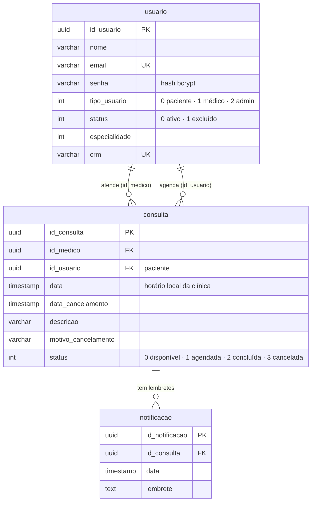

# Clinix — Backend

API REST do Clinix, sistema de agendamento de consultas médicas. Pacientes agendam, cancelam e reagendam consultas; médicos e administradores gerenciam a agenda e os usuários.

- **Frontend:** [clinix-frontend](https://github.com/leorossiio/clinix-frontend)
- **Documentação interativa da API:** `http://localhost:3000/api-docs` (com a API rodando)
- **Glossário do domínio:** [CONTEXT.md](CONTEXT.md) · **Decisões de arquitetura:** [docs/adr](docs/adr) · **Mudanças da v2:** [CHANGELOG.md](CHANGELOG.md)

## Sumário

- [Como rodar](#como-rodar)
- [Scripts](#scripts)
- [Arquitetura](#arquitetura)
- [Regras de negócio](#regras-de-negócio)
- [Endpoints](#endpoints)
- [Testes](#testes)
- [CI/CD com Jenkins](#cicd-com-jenkins)
- [Modelo de dados](#modelo-de-dados)
- [Backlog do Jira](#backlog-do-jira)

## Como rodar

Requisitos: Node.js 20.12 ou superior.

```bash
npm install

# Sem nenhuma credencial: banco em memória com dados de demonstração
npm run dev:memoria
```

Usuários de demonstração (senha `clinix123` para todos): `paciente@clinix.dev`, `medica@clinix.dev`, `medico@clinix.dev`, `admin@clinix.dev`. Os dados somem ao reiniciar.

Para usar o Supabase, copie `.env.example` para `.env`, preencha `JWT_SECRET` e `SUPABASE_KEY` e rode:

```bash
npm run dev      # recarrega ao salvar
npm start        # produção
```

Se faltar alguma variável obrigatória, a API não sobe e diz qual é. Todas as variáveis estão documentadas em [.env.example](.env.example).

Com Docker:

```bash
docker build -t clinix-backend .
docker run -p 3000:3000 --env-file .env clinix-backend
```

## Scripts

| Comando                               | O que faz                                             |
| ------------------------------------- | ----------------------------------------------------- |
| `npm run dev` / `npm run dev:memoria` | API com recarga automática (Supabase / memória)       |
| `npm start`                           | API em modo produção                                  |
| `npm test`                            | Todos os testes                                       |
| `npm run test:watch`                  | Testes em modo observação (ciclo TDD)                 |
| `npm run test:coverage`               | Testes + relatório de cobertura em `reports/coverage` |
| `npm run lint` / `npm run format`     | ESLint / Prettier                                     |

## Arquitetura

Camadas com dependências apontando só para dentro ([ADR 0001](docs/adr/0001-arquitetura-em-camadas.md)):

```
interfaces/http  ──▶  application  ──▶  domain
       │                   │               ▲
       └──────── container.js (monta tudo) │
                           │               │
                   infrastructure ─────────┘
          (Supabase, memória, bcrypt, JWT, fuso horário)
```

```
src/
├── domain/                 Regras de negócio puras — sem Express, sem banco, sem relógio
│   ├── consulta/           Consulta (agregado), status, política de reagendamento, agenda
│   ├── usuario/            Usuario, perfis, especialidades
│   ├── notificacao/        Lembrete de consulta
│   └── erros.js            Erros de negócio (viram status HTTP na borda)
├── application/            Casos de uso + autorização por dono do recurso
├── infrastructure/
│   ├── supabase/           Repositórios reais (único lugar que conhece tabelas/colunas)
│   ├── memoria/            Repositórios em memória (testes e modo demonstração)
│   ├── seguranca/          Hash de senha (bcrypt) e tokens (JWT)
│   └── tempo/              Conversão de fuso na fronteira com o banco
├── interfaces/http/        Express: rotas, validação (Joi), apresentação JSON, erros
├── container.js            Raiz de composição: escolhe as implementações
├── config.js               Lê e valida variáveis de ambiente
└── server.js               Sobe o servidor
```

Convenções:

- **Autorização por perfil** (ex.: "só admin lista usuários") fica nas rotas, com `permitir(...)`. **Autorização por dono** (ex.: "só o paciente dono cancela") fica na aplicação, que carrega o recurso antes de decidir.
- **Validação de formato** (Joi, em `esquemas.js`) é separada de **regra de negócio** (no domínio). Formato inválido → `400`; regra violada → `422`.
- Toda regra dependente de tempo recebe `agora` por parâmetro; em produção vem de um relógio injetado.
- As respostas são montadas por listas explícitas de campos (`apresentadores.js`): nada da entidade vaza para a API por acidente.

## Regras de negócio

Vocabulário completo em [CONTEXT.md](CONTEXT.md).

| Regra                                                                                                                 | Onde                                                                                                       |
| --------------------------------------------------------------------------------------------------------------------- | ---------------------------------------------------------------------------------------------------------- |
| Auto-cadastro sempre cria **paciente**; conta excluída é reativada ao se cadastrar de novo                            | `Usuario.registrarPaciente` / `reativarComoPaciente`                                                       |
| Horários só podem ser abertos no futuro, e o médico não pode ter dois horários ativos no mesmo instante (CLINIXSM-45) | `Consulta.abrirHorario`, `agenda.js`                                                                       |
| Médico gerencia a **própria** agenda; administrador, qualquer uma                                                     | `autorizacao.js`                                                                                           |
| Paciente agenda apenas horário disponível e futuro; dois pacientes não pegam o mesmo horário (concorrência otimista)  | `Consulta.agendar`, repositórios                                                                           |
| Paciente cancela com motivo e **no mínimo 24h** de antecedência (CLINIXSM-50)                                         | `Consulta.cancelarPeloPaciente`                                                                            |
| Paciente desfaz o **cancelamento mais recente** em até **3 dias**, se a consulta ainda não passou                     | `Consulta.reagendar`, `politicaDeReagendamento.js`                                                         |
| Remoção pela clínica não pode ser desfeita pelo paciente                                                              | `Consulta.removerPelaClinica` ([ADR 0003](docs/adr/0003-remocao-pela-clinica-sem-data-de-cancelamento.md)) |
| Paciente vê horários livres futuros + as próprias consultas; médico, a própria agenda; admin, tudo                    | `ServicoDeConsultas.listar`                                                                                |

## Endpoints

Detalhes, exemplos e schemas no Swagger (`/api-docs`), gerado a partir de [docs/openapi.yaml](docs/openapi.yaml).

| Método         | Rota                                                  | Quem pode                             |
| -------------- | ----------------------------------------------------- | ------------------------------------- |
| `POST`         | `/auth/login`                                         | público (limite de tentativas por IP) |
| `POST`         | `/usuarios`                                           | público — cadastro de paciente        |
| `GET`          | `/usuarios`                                           | administrador                         |
| `GET`          | `/usuarios/medicos`                                   | autenticado                           |
| `GET` `PUT`    | `/usuarios/:id`                                       | o próprio usuário ou administrador    |
| `DELETE`       | `/usuarios/:id`                                       | administrador                         |
| `GET`          | `/consultas`                                          | autenticado (recorte por perfil)      |
| `GET`          | `/consultas/:id`                                      | quem pode ver a consulta              |
| `POST`         | `/consultas`                                          | médico ou administrador               |
| `PUT` `DELETE` | `/consultas/:id`                                      | médico responsável ou administrador   |
| `PUT`          | `/consultas/:id/agendar` · `/cancelar` · `/reagendar` | paciente                              |
| `GET` `POST`   | `/notificacoes`                                       | médico responsável ou administrador   |
| `GET`          | `/health`                                             | público                               |

## Testes

Escritos em TDD (vermelho → verde), verificando **comportamento** por interfaces públicas:

| Camada      | Onde                        | O que garante                                                            |
| ----------- | --------------------------- | ------------------------------------------------------------------------ |
| Domínio     | `tests/unit/domain`         | Regras de negócio, com relógio fixo                                      |
| Adaptadores | `tests/unit/infrastructure` | Hash de senha (inclusive legado) e fuso horário                          |
| Contrato    | `tests/contrato`            | Repositório em memória e Supabase se comportam igual                     |
| API         | `tests/integracao/http`     | Fluxos completos via HTTP: autenticação, autorização, status e respostas |

Os testes da API sobem a aplicação inteira com repositórios em memória (`tests/apoio/cenario.js`), então rodam em segundos e sem rede. O único dublê é o banco — e o contrato garante que ele se comporta como o real.

Para rodar o contrato contra um Supabase **de testes** (os testes gravam dados — nunca use o de produção):

```bash
SUPABASE_TEST_URL=https://<projeto-de-teste>.supabase.co SUPABASE_TEST_KEY=<chave> npm test
```

A cobertura mínima (linhas 85%, branches 80%) é exigida em `vitest.config.js`; o build falha abaixo disso.

## CI/CD com Jenkins

O [Jenkinsfile](Jenkinsfile) define:

1. **Build e testes** (container `node:22-alpine`): `npm ci` → lint, formatação e `npm audit` em paralelo → testes com cobertura (relatórios JUnit e Cobertura publicados no Jenkins).
2. **Imagem Docker** (somente `main`): build da imagem e **smoke test** — sobe o container em modo memória e confere o `/health`.
3. **Publicação e deploy** (somente `main` com o parâmetro `DEPLOY`): push para o registro e atualização do App Service no Azure.

Plugins: Pipeline, Docker Pipeline, JUnit, Coverage, Workspace Cleanup e Timestamper. As credenciais esperadas estão descritas no topo do Jenkinsfile. Crie o job como _Multibranch Pipeline_ apontando para este repositório.

## Modelo de dados

Scripts em [database/migrations](database/migrations). O diagrama e o modelo em `docs/historico` são da primeira versão e estão desatualizados.



## Backlog do Jira

Situação, após a v2, dos itens que estavam em "Aguardando Dev" (21/05):

| Item                                                      | Situação                                                     |
| --------------------------------------------------------- | ------------------------------------------------------------ |
| CLINIXSM-39 — Integrar filtro com a lista de resultados   | Feito (frontend)                                             |
| CLINIXSM-41 — Loading enquanto carrega                    | Feito (frontend: loading real durante a requisição)          |
| CLINIXSM-43 — Filtros não reiniciam ao navegar            | Feito (frontend)                                             |
| CLINIXSM-45 — Validar disponibilidade do médico e horário | Feito: horário no futuro e sem conflito na agenda do médico  |
| CLINIXSM-46 — Regras de negócio no agendamento            | Feito: só horário disponível e futuro, sem agendamento duplo |
| CLINIXSM-50 — Cancelamento com 24h de antecedência        | Feito                                                        |
